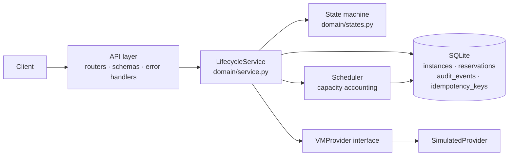
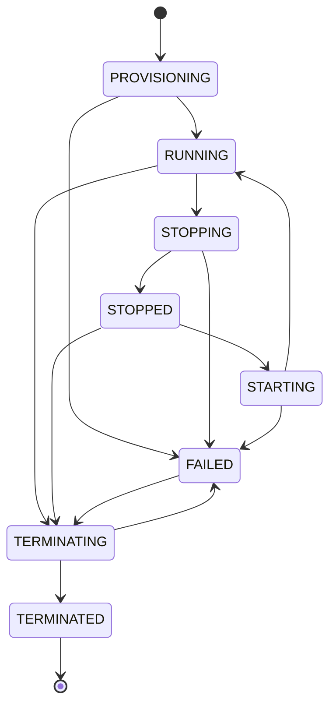

# VM Lifecycle Manager

A mini cloud-infrastructure **control plane**: a REST service that manages virtual-machine lifecycle (create, start, stop, terminate), schedules CPU/memory against a host, and keeps an audit trail.

> **The VM provider is simulated.** No real virtual machines are created, and the simulated provider is not a hypervisor. The provider interface is designed so a real backend can be added later. This is a portfolio/learning project and is **not production-ready**.

## Problem statement

A control plane must keep three things consistent while the real world (a hypervisor) fails independently of it: *what state each VM is in*, *how much capacity is promised*, and *what happened and when*. This project implements those concerns with an explicit state machine, transactional resource accounting, crash-aware reconciliation, and tests that attack the race and failure windows.

## Scope and non-goals

In scope: REST API, state machine, single-host scheduler, provider abstraction + simulated provider, SQLite persistence, audit events, idempotent create, optional API-key auth, reconciliation, tests.

Non-goals: real virtualization, multi-host scheduling, networking/storage/images, multi-tenancy/RBAC, async job queues, HA, metrics/tracing.

## Architecture



Dependency direction: `api -> domain -> (providers, db)`. Route handlers only parse input, call the service, and shape output.

## Repository structure

```
src/vmlm/
  config.py            Settings from VMLM_* env vars
  logging_config.py    JSON-lines structured logging
  main.py              App factory (wiring, startup reconcile)
  api/                 routers.py · schemas.py · errors.py · deps.py
  domain/              states.py · service.py · scheduler.py · errors.py
  providers/           base.py (interface) · simulated.py
  db/                  models.py · session.py (SQLite BEGIN IMMEDIATE)
tests/                 state machine, scheduler, API, concurrency, reconcile/restart
scripts/demo.sh        end-to-end demo
```

## Setup (macOS)

```bash
python3 -m venv .venv && source .venv/bin/activate
pip install -e ".[dev]"
```

Requires Python 3.11+.

## Run

```bash
uvicorn vmlm.main:create_app --factory --reload
# docs: http://127.0.0.1:8000/docs
```

Configuration (all optional): `VMLM_DATABASE_URL` (default `sqlite:///./vmlm.db`), `VMLM_HOST_VCPUS` (16), `VMLM_HOST_MEMORY_MIB` (65536), `VMLM_API_KEY` (unset = auth disabled; set it to require an `X-API-Key` header on `/v1/*`), `VMLM_LOG_LEVEL`.

## API

| Method | Path | Success | Notes |
|---|---|---|---|
| POST | `/v1/instances` | 201 (200 on idempotent replay) | optional `Idempotency-Key` header |
| GET | `/v1/instances` | 200 | `limit` (1-100), `offset`, `state` filter |
| GET | `/v1/instances/{id}` | 200 | |
| POST | `/v1/instances/{id}/start` | 200 | STOPPED -> RUNNING |
| POST | `/v1/instances/{id}/stop` | 200 | RUNNING -> STOPPED |
| DELETE | `/v1/instances/{id}` | 200 | terminate; record kept as TERMINATED |
| GET | `/v1/instances/{id}/events` | 200 | paginated audit log |
| GET | `/v1/hosts/capacity` | 200 | total / reserved / available |
| GET | `/health` | 200 / 503 | checks the database; no auth |

Errors share one shape: `{"error": {"code", "message", "details"}}`. Status mapping: 404 `instance_not_found`, 409 `invalid_transition` / `insufficient_capacity` / `idempotency_conflict` / `concurrent_modification`, 422 `validation_error`, 401 `unauthorized`, 502 `provider_operation_failed`.

```bash
curl -s -X POST localhost:8000/v1/instances -H 'Content-Type: application/json' \
  -H 'Idempotency-Key: demo-1' -d '{"name":"web-1","vcpus":2,"memory_mib":4096}'
```
```json
{"id":"b43283eb-6a25-45a7-afe1-299efa29c900","name":"web-1","vcpus":2,"memory_mib":4096,
 "state":"RUNNING","provider_id":"vm-b43283eb-...","failure_reason":null,"version":2,
 "created_at":"2026-10-24T14:03:27.710699Z","updated_at":"2026-10-24T14:03:27.728090Z"}
```
```json
{"error":{"code":"insufficient_capacity","message":"host does not have enough free capacity",
 "details":{"requested_vcpus":20,"requested_memory_mib":4096,"available_vcpus":14,"available_memory_mib":61440}}}
```

Demo (create -> capacity -> stop -> start -> delete -> events): start the server, then `bash scripts/demo.sh` (set `VMLM_API_KEY` in the environment if auth is on). It was run against a live server during development.

## State machine



* The `-ING` states are committed **before** the provider is called, so a crash leaves a visible marker for reconciliation.
* Any transition not in the table returns **409 `invalid_transition`** with the current and target state. Tests check all 64 state pairs against this table.
* `FAILED` is not recoverable by start/stop; the only exit is terminate (cleanup).
* **Termination vs deletion.** `DELETE` *terminates*: the VM is destroyed at the provider, its reservation is released, and the row stays as `TERMINATED` for audit and is still readable. There is no hard delete/purge. A second `DELETE` returns 409.

## Resource accounting rules

* One host with configurable vCPU and MiB. `available = total - sum(reservations)`; both dimensions must fit (exact fit allowed).
* A reservation is a row keyed by `instance_id` (primary key => no double allocation). Release deletes the row and returns `False` if there was none (double release is a no-op, and the `resources_released` audit event is written only when a row was actually deleted).
* Reserved at create. Held through STOPPED/FAILED-after-start (a VM may still exist). Released on terminate and on **provisioning failure** (rollback).
* Non-positive values are rejected by API validation (422), by the scheduler (`ValueError`), and by DB `CHECK` constraints.
* State is in the database, so capacity is reconstructed exactly after a restart.

### Concurrency guarantees

Every transaction begins with SQLite `BEGIN IMMEDIATE`, which takes the database write lock up front. "Sum reservations, compare, insert" therefore cannot interleave with another writer, whether the writer is another thread or another **process on the same machine** sharing the database file. Instance rows also carry a `version`; the operation's final step fails with 409 `concurrent_modification` if the row changed after the transitional state was committed. There is deliberately **no in-process lock** doing the real work. This is not a distributed lock: it gives no guarantees across hosts, and SQLite on network filesystems is unsafe. All transactions (including reads) take the write lock, which is simple and correct but limits throughput.

Complexity: capacity check is O(R) in live reservations (a SUM scan); listing is O(limit) with offset pagination; storage is O(instances + events).

## Provider abstraction and reconciliation

`VMProvider` has `provision / start / stop / inspect / delete`, all keyed by a `provider_id` the control plane chooses (`vm-<instance id>`). Because the key is chosen up front, `provision` and `delete` are idempotent and safe to retry.

Operation shape: (1) short transaction commits the transitional state; (2) provider call, with no DB lock held; (3) short transaction commits the outcome. If the provider fails: provisioning failure -> `FAILED` + reservation released; start/stop failure -> `FAILED`, reservation kept; delete failure -> `FAILED`, reservation kept, `DELETE` can be retried.

**Provider succeeded but the DB update did not** (crash between 2 and 3): the row is left in `PROVISIONING/STARTING/STOPPING/TERMINATING`. `reconcile()` runs at startup, inspects the provider for each such row, and completes or fails it (`PROVISIONING` with no VM -> `FAILED` and release; `TERMINATING` -> finish deletion and release). Each fix goes through the version check, so it cannot overwrite an operation still in flight, and it is recorded in the audit log. Unreachable provider -> the row is skipped, not guessed. Reconciliation does **not** detect steady-state drift (a RUNNING row whose VM disappeared).

### Idempotency, retry safety, duplicate prevention

* **Idempotency**: repeating a request has the same effect as sending it once. `POST /instances` with the same `Idempotency-Key` and body returns the original instance (200), reserving once. Same key + different body -> 409. A rejected create does not consume the key. A key replays the original *outcome*, including a `FAILED` instance; use a new key to retry provisioning.
* **Retry safety**: a failed or timed-out call can be repeated without harm. Provider calls are keyed and idempotent; `DELETE` after a failed delete retries cleanly.
* **Duplicate-operation prevention**: concurrent conflicting operations on one instance (two stops) are blocked by the state machine plus the version check, so only one reaches the provider.

## Testing

```bash
pytest -q
ruff check . && ruff format --check .
```

Actual result of the last run (Windows 11, Python 3.13.15, fastapi 0.162.0, SQLAlchemy 2.0.55, pydantic 2.14.1):

```
129 passed, 1 warning in 10.80s
ruff check: All checks passed!    ruff format --check: 27 files already formatted
```

The warning is a Starlette deprecation notice about `httpx` in `TestClient`. **Not yet run on macOS Apple Silicon**; run the commands above there to confirm. Coverage by area: state machine (all 64 pairs), scheduler (overflow on each dimension, exact fit, double allocate/release, non-positive), API (create, validation, capacity, start/stop, illegal transitions, delete-once, provision/start/stop/delete failures, audit, 404s, pagination, idempotency, auth), concurrency (24 parallel creates across two engines never overcommit, mixed-size stress with fixed seed, concurrent stop/delete/idempotent-create), crash windows and reconciliation, restart persistence, structured logs.

## Design decisions and trade-offs

* SQLite + `BEGIN IMMEDIATE`: easy to reason about and test, but single-node and write-serialized.
* Provider calls outside DB transactions: no lock held during slow external calls; costs intermediate states and the need for reconciliation.
* Synchronous operations: simple; a real system would use async tasks/workers with the same state machine.
* Terminate keeps the row: preserves audit history; no purge.
* Optional API key: minimal, constant-time compare; not a substitute for real authn/authz.

## Known limitations

* The provider is simulated and in-memory. After a process restart it forgets its VMs, so start/stop of pre-restart instances would fail against a *fresh* simulated provider (tests keep one provider object across the "restart" to model an external hypervisor).
* Reconciliation runs only at startup, never periodically, and ignores steady-state drift.
* Single writer at a time; reads also take the write lock; not safe on network filesystems or multi-host.
* Idempotency keys never expire and are not scoped per caller.
* No pagination cursor stability under concurrent inserts (offset-based).
* A non-`ProviderError` exception from a provider leaves the row transitional until reconcile (restart).
* Not run on macOS yet; no load testing; no type-checker (mypy) run.

## Security considerations

No secrets in code (config via env). Inputs validated by Pydantic (strict ints, bounded sizes, name pattern, unknown fields rejected). No user-supplied command execution anywhere. Unhandled errors return a generic 500 without internals. Optional API key uses `secrets.compare_digest`. A real control plane would additionally need TLS, real identity and per-tenant authorization, rate limiting/quotas, secret management, audit-log tamper resistance, and request IDs/tracing.

## Roadmap for real virtualization

1. Implement `VMProvider` for libvirt/QEMU (or a cloud SDK) behind the same interface; map real states to `ProviderVMState`.
2. Move operations to an async worker with a durable task queue; keep the transitional states.
3. Periodic reconciliation loop with drift detection and alerting.
4. Postgres (row locks / `SELECT ... FOR UPDATE`) and multi-host scheduling with placement policies.
5. Images, networking, storage, quotas, and tenant isolation; metrics and tracing.
