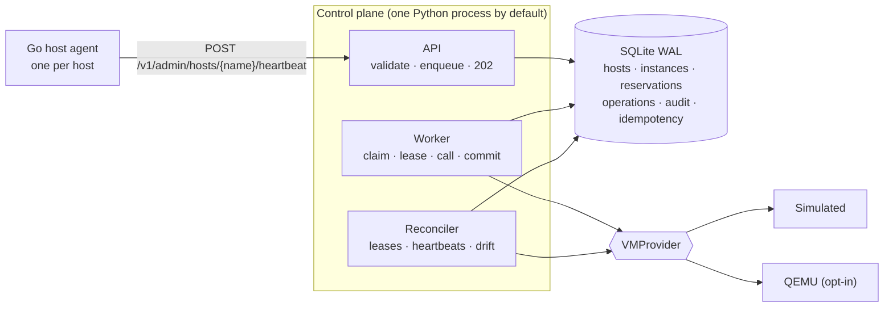
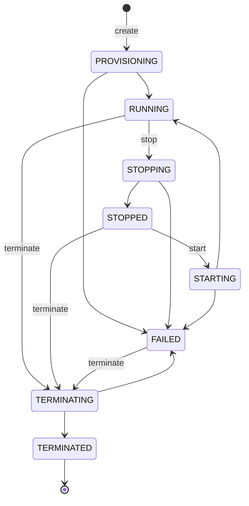

# VM Lifecycle Manager

[](https://github.com/Ishaanz-pro/vm-lifecycle-manager/actions/workflows/ci.yml)


**Live demo (simulated provider, no real VMs):** [vm-lifecycle-manager.onrender.com](https://vm-lifecycle-manager.onrender.com) opens an interactive dashboard: create VMs, stop/start/terminate them, and watch each operation move through the queue and the audit trail. REST docs are at [/docs](https://vm-lifecycle-manager.onrender.com/docs). Free tier: the first request after idle can take about a minute, and the demo database resets on restart.

A mini cloud-infrastructure **control plane**: a REST API that accepts VM lifecycle requests,
schedules them onto hosts with capacity accounting, executes them asynchronously through a
durable, lease-based operation queue, and continuously reconciles what it *recorded* with
what the virtualization layer *reports*. A small Go agent heartbeats real host capacity
into it.

> **Scope, honestly stated.** This is a local learning and portfolio project. It is not
> production-ready, not hardened for multi-tenant use, and not comparable to a real cloud
> control plane. The default VM provider is **simulated** (no VMs are created). An opt-in
> QEMU provider runs real local VMs, but its real-boot path has **not** been verified by
> the author (see [Verification status](#verification-status)).

| | |
|---|---|
| Control plane | Python 3.11+ · FastAPI · Pydantic v2 · SQLAlchemy 2 · SQLite (WAL) |
| Host agent | Go 1.22+, standard library only |
| Dashboard | Built-in browser UI at `/ui/` (no framework, no build step, CSP) |
| Packaging | Docker (non-root, read-only rootfs), Compose, Kubernetes manifests, air-gap bundle |
| Tests | 218 Python tests (deterministic: injected clock, no sleeps) · Go unit tests with `-race` |

## Contents

[Problem](#problem-statement) · [Architecture](#architecture) · [Lifecycle](#lifecycle-and-state-machine) · [Scheduling](#resource-scheduling) · [Reliability](#reliability) · [API](#api) · [Run on macOS](#run-locally-macos-apple-silicon) · [Docker](#docker) · [Go agent](#go-host-agent) · [Kubernetes](#kubernetes-optional) · [Tests](#tests-and-results) · [Benchmarks](#benchmark) · [Security](#security) · [Limitations](#known-limitations) · [Docs](#further-reading)

## Problem statement

A control plane must keep three things consistent while the machines underneath fail
independently of it: **what state each VM is in**, **how much capacity has been promised**,
and **what work is still outstanding**. The hard parts are the gaps: a request accepted but
not yet executed, a VM created but its success not yet recorded, a worker that dies mid-call,
a VM that changes state behind the control plane's back, and a client that retries.

This project closes each gap with a specific mechanism and a deterministic test that forces
the failure:

* durable operations written in the same transaction as the state change
* lease-based workers whose crashes are recovered by lease expiry, not failure detection
* idempotent, keyed provider calls so at-least-once execution is safe
* optimistic versioning so a stale worker cannot overwrite a newer outcome
* a reconciler that corrects observed drift through an explicit table
* transactional capacity accounting that cannot over-commit a host under concurrency

**Non-goals:** guest networking/storage/images, multi-tenancy and RBAC, HA of the control
plane itself, distributed consensus, multi-region anything.

## Architecture



The API and worker communicate only through the database, so the worker can run in-process
(default, one command on a laptop) or as separate processes (`python -m vmlm.worker_main`),
and nothing accepted is lost when a process dies. Component table, request sequence diagram,
logs-vs-metrics-vs-traces-vs-audit, and the metric catalogue:
[docs/architecture.md](docs/architecture.md).

```
src/vmlm/
  api/            routers (thin) · schemas · errors · auth deps · request-ID/metrics middleware
  domain/         states (tables) · core (tx, transitions, audit) · service (request path)
                  worker · reconciler · scheduler · failures (dev-only injection)
  providers/      base (protocol + error taxonomy) · simulated · qemu · factory
  db/             models · session (SQLite BEGIN IMMEDIATE / deferred-read split)
  observability/  metrics registry · correlation context
  sysinfo.py      safe subprocess, signals, pids, resources, ports, virtualization detection
  main.py         app factory, worker/reconcile threads, graceful shutdown
  worker_main.py  standalone worker process
agent/            Go host agent: cmd/hostagent · internal/{probe,heartbeat,server}
deploy/           k8s/ manifests · airgap/ bundle scripts
scripts/          demo.sh · smoke.py (stdlib only) · loadtest.py
docs/             architecture · state-machine · reliability · virtualization
                  troubleshooting · air-gapped-exercise · design-decisions
```

## Lifecycle and state machine



Transitions are a table (`domain/states.py`), applied through one function that validates,
bumps the version and writes the audit record. Illegal transitions return
`409 invalid_transition`; all 64 state pairs are tested. `-ING` states are committed *before*
the provider call so a crash leaves a typed marker. `DELETE` **terminates** (VM destroyed,
capacity released, record kept as `TERMINATED`); there is no purge.
Full rules, desired-state model and reconciler correction table:
[docs/state-machine.md](docs/state-machine.md).

## Resource scheduling

* Hosts have total vCPU/MiB, live reservations, and a status: `READY`, `DRAINING`
  (operator: keep instances, accept no new ones), `UNHEALTHY` (agent heartbeat stale).
* **Policy: best fit by memory.** Among READY hosts where both dimensions fit, pick the one
  with the least memory left afterwards; tie-break by least vCPU left, then host name.
  O(R + H) per placement (one GROUP BY over reservations, one scan of hosts).
* Reservation = row keyed by `instance_id` → double allocation impossible; release deletes
  the row and reports whether it existed → double release is a no-op.
* Reserved at **accept** time; held through stop and through FAILED-after-start (the VM may
  exist); released on terminate or on provisioning failure (rollback). Never leaked by a
  provider failure: every path is tested.
* Concurrency: placement runs inside `BEGIN IMMEDIATE` (SQLite's single write lock, shared
  by every process on the same file). 24 concurrent creates from two independent engines
  against a host with room for 8: exactly 8 succeed. No in-process lock is involved, and this
  is **not** a distributed lock: it gives no guarantee across machines.

## Reliability

At-least-once execution, made safe by idempotent provider calls; bounded retries with
exponential backoff and full jitter; transient vs permanent error classification;
lease-based crash recovery; idempotency keys (with expiry and conflict detection) on every
mutating endpoint; startup and periodic reconciliation. Every injectable failure (provider
error, timeout, delay, worker crash, DB error, duplicates, exhaustion, drift, host loss) has
a deterministic test and a documented recovery: [docs/reliability.md](docs/reliability.md).

Failure injection is **development-only**: off unless `VMLM_FAILURE_INJECTION_ENABLED=true`,
and behind the admin key when one is set.

## API

All mutating calls are asynchronous: `202 Accepted` + an operation + `Location:
/v1/operations/{id}`. Add `?wait=<seconds>` (≤ 30) to have the server wait: `200` if it
finished, `202` if not. An idempotent replay returns `200` with the original operation.

| Method | Path | Notes |
|---|---|---|
| POST | `/v1/instances` | `Idempotency-Key` optional |
| GET | `/v1/instances` | `state`, `limit` (1–100), `offset` |
| GET | `/v1/instances/{id}` | |
| POST | `/v1/instances/{id}/start` · `/stop` | `Idempotency-Key` optional |
| DELETE | `/v1/instances/{id}` | terminate |
| GET | `/v1/instances/{id}/events` | audit trail, paginated |
| GET | `/v1/instances/{id}/operations` | operation history |
| GET | `/v1/operations/{id}` | poll async work |
| GET | `/v1/hosts` · `/v1/hosts/capacity` | per-host and summed capacity |
| POST | `/v1/admin/hosts/{name}/heartbeat` · `/status` | agent API; drain/undrain (admin) |
| POST | `/v1/admin/reconcile` · `/worker/drain` · GET `/v1/admin/system` | admin |
| POST/GET | `/v1/debug/failures` | dev-only failure injection (admin) |
| GET | `/health` · `/ready` · `/metrics` | liveness · readiness · Prometheus text |

Errors: `{"error": {"code", "message", "details", "request_id"}}`: 401 `unauthorized`,
403 `forbidden`/`feature_disabled`, 404 `*_not_found`, 409 `invalid_transition` /
`insufficient_capacity` / `idempotency_conflict` / `concurrent_modification`,
422 `validation_error`, 500 `internal_error` (no stack trace, ever). OpenAPI at `/docs`.

```bash
$ curl -s -X POST localhost:8000/v1/instances -H 'Content-Type: application/json' \
    -H 'Idempotency-Key: web-1' -d '{"name":"web-1","vcpus":2,"memory_mib":2048}'
{"id":"1dd8713f-...","instance_id":"9be2b1e8-...","action":"create","status":"PENDING",
 "from_state":"PROVISIONING","target_state":"RUNNING","attempts":0,"max_attempts":3,...}

$ curl -s localhost:8000/v1/operations/1dd8713f-...
{"id":"1dd8713f-...","status":"SUCCEEDED","attempts":1,"error":null,...}

$ curl -s -X POST localhost:8000/v1/instances -H 'Content-Type: application/json' \
    -d '{"name":"huge","vcpus":999,"memory_mib":1024}'
{"error":{"code":"insufficient_capacity","message":"no host has enough free capacity",
 "details":{"reason":"insufficient_capacity","requested_vcpus":999,...},"request_id":"3fcb..."}}
```

## Run locally (macOS, Apple Silicon)

Needs Python 3.11+ (`brew install python@3.13`); Go 1.22+ only for the agent. Everything
runs natively on arm64; no hypervisor is needed for the default simulated provider.

```bash
python3 -m venv .venv && source .venv/bin/activate
pip install -e ".[dev]"
uvicorn vmlm.main:create_app --factory            # http://127.0.0.1:8000/docs
bash scripts/demo.sh                               # create → capacity → stop → start → terminate → audit
python scripts/smoke.py                            # stdlib-only assertions of the same flow
python -m vmlm.sysinfo                             # OS / CPU / memory / virtualization report
```

Configuration is environment-only (`VMLM_*`, see `src/vmlm/config.py`). Unsafe combinations
are rejected at startup (e.g. a worker lease not longer than the provider timeout). Hosts:
`VMLM_HOSTS='[{"name":"h1","vcpus":16,"memory_mib":65536}]'`.

## Docker

```bash
cp .env.example .env               # then set real random keys
docker compose up --build          # api + separate worker process + Go agent
python scripts/smoke.py --api-key "$(grep ADMIN .env | cut -d= -f2)"
```

Images run as non-root with a read-only root filesystem, all capabilities dropped,
`no-new-privileges`, resource limits, health checks, and secrets only via environment.
Multi-arch base images build natively on M1.

### Dashboard and demo deployment on Render (optional)

The control plane serves a small dependency-free dashboard at `/ui/` (plain HTML/CSS/JS, no
build step, no third-party requests, strict Content-Security-Policy). It uses only the public
REST API: host capacity, create with an `Idempotency-Key`, start/stop/terminate, a per-instance
operation and audit-event view, and a log of the API calls the page itself made. Presets
include an oversized request (to see a `409` capacity rejection) and a "replay last create"
button (to see an idempotent replay return `200` with the same operation).

`render.yaml` is a Render Blueprint that runs the `Dockerfile` with the **simulated** provider
(no real VMs) in `VMLM_DEMO_MODE`: `/ui/config` then hands the page the **user-tier** API key
so a visitor can try it without being given one. The admin key is never exposed, failure
injection must be off, and the settings validator refuses demo mode otherwise. In Render:
New → Blueprint → select this repository; Render generates both keys (visible only in its
dashboard).

Limits to know: anyone who opens the page can create and terminate VMs on the demo, capacity
is finite (3 small hosts) so abuse is bounded, but there is **no rate limiting**. The free tier
sleeps when idle and its database resets on restart. Treat a public instance as a demo only.
The page's JavaScript has been syntax-checked and the exact API flow it performs is covered by
`tests/test_ui.py` and was exercised against a live local server; it has not been tested
across browsers.

## Go host agent

```bash
cd agent
go test -race ./...
go run ./cmd/hostagent -host agent-host -control-plane http://127.0.0.1:8000   # VMLM_AGENT_API_KEY=<admin key>
```

Measures CPUs and memory (Linux `/proc/meminfo`, macOS `sysctl hw.memsize`, Windows
`GlobalMemoryStatusEx`), subtracts a host reservation, and heartbeats it with per-request
deadlines and capped, jittered exponential backoff. Serves `/healthz`, `/readyz` (ready only
after a recent accepted heartbeat) and `/v1/status`; shuts down gracefully on SIGINT/SIGTERM.
Why Go here and Python elsewhere: [docs/design-decisions.md](docs/design-decisions.md).
The control plane works without it (static hosts).

## Kubernetes (optional)

```bash
kind create cluster
docker build -t vm-lifecycle-manager:local . && docker build -t vmlm-hostagent:local agent
kind load docker-image vm-lifecycle-manager:local vmlm-hostagent:local
kubectl create namespace vmlm
kubectl -n vmlm create secret generic vmlm-secrets \
  --from-literal=api-key="$(openssl rand -hex 16)" --from-literal=admin-api-key="$(openssl rand -hex 16)"
kubectl apply -k deploy/k8s
kubectl -n vmlm port-forward svc/vmlm-api 8000:8000
```

One-replica `Recreate` Deployment (SQLite allows one writer), PVC, ConfigMap, Secret
references, liveness/readiness/startup probes, requests/limits, restricted security
context; the agent is a DaemonSet keyed by node name. The manifests explain what happens on
pod restart, unhealthy probes and rescheduling. These are **unverified** manifests (see
below); writing YAML is not Kubernetes experience.

Air-gapped deployment exercise (pinned, checksummed, offline-verified bundle):
[docs/air-gapped-exercise.md](docs/air-gapped-exercise.md).

## Tests and results

```bash
pytest -q -rs                       # Python: unit, API contract, concurrency, crash, restart
ruff check . && ruff format --check .
cd agent && go vet ./... && go test -race ./...
```

| Suite | What it covers |
|---|---|
| `test_state_machine.py` | all 64 transitions; action/correction tables are mutually legal |
| `test_scheduler.py` | best fit, tie-breaks, per-host limits, ineligible hosts, double alloc/release, DB constraints |
| `test_api.py` | async contract, validation, auth tiers, idempotency (incl. expiry), lifecycle, failures, pagination |
| `test_worker.py` | retries, backoff bounds, timeouts, leases, crash/DB-error recovery, stale outcomes |
| `test_concurrency.py` | concurrent creates on 1–2 hosts, two workers, conflicting actions, idempotent races |
| `test_reconcile_and_restart.py` | drift repair, missing VMs, heartbeats, restart persistence, startup recovery |
| `test_observability.py` | metric format, bounded labels, correlation IDs in logs, no leaks in 500s |
| `test_sysinfo.py` · `test_qemu_provider.py` | no-shell subprocess, timeouts, orphan killing, signals; QEMU gating/argv/QMP |
| `test_config.py` · `test_regressions.py` | unsafe-config rejection; one test per bug found |

**Actual results** (last run, Windows 11, Python 3.13.15, dependencies from `requirements.lock`):

```
pytest:  200 passed, 3 skipped          (skips: 2 POSIX-only signal tests, 1 opt-in real-QEMU test)
ruff:    All checks passed!
go:      ok internal/heartbeat · ok internal/probe · ok internal/server   (go test -race, go 1.26.5)
         cross-compiled for darwin/arm64 and linux/arm64
```

Bugs found after the first implementation, each with a regression test in
`tests/test_regressions.py` or `tests/test_config.py`:

1. A new request without `?wait` returned `200` instead of `202` when a fast worker finished
   it before the response was built (found by the load test).
2. Read-only transactions took the write lock, so throughput *fell* as clients were added
   (found by the load test; see benchmark).
3. `repr(Settings)` printed API keys; they are now `SecretStr`.
4. Nothing prevented `worker_lease_s <= provider_timeout_s`, under which a healthy worker's
   operation could be re-run by another; now rejected at startup.

## Benchmark

`scripts/loadtest.py`: C concurrent closed-loop clients run 200 create→terminate cycles.
Simulated provider (≈0 ms provider latency, so this measures the control plane only),
one uvicorn process, SQLite, client on the same Windows 11 laptop (8 logical CPUs).

| Build | C | Throughput | End-to-end p95 | p99 |
|---|---|---|---|---|
| before read/write split | 8 | 18.2 ops/s | 1442 ms | 2744 ms |
| after (3 runs) | 8 | 33.6–34.3 ops/s | 273–359 ms | 705–1294 ms |
| after | 1 | 28.3 ops/s | 54 ms | 57 ms |

Accept-path p99 at C=8 is still 1.4–1.8 s (single SQLite write lock). A follow-up
optimisation was measured, showed no gain, and was reverted; details in
[docs/design-decisions.md](docs/design-decisions.md). These are single-machine numbers, not
a capacity claim.

## Security

Strict request validation (strict ints, bounds, name pattern, unknown fields rejected);
two-tier API keys with constant-time comparison (`/v1` vs `/v1/admin` + `/v1/debug`);
health/readiness/metrics unauthenticated by design (metrics expose configured host names);
no arbitrary command execution anywhere, and every subprocess is an argv list with a timeout
and an executable allow-list; provider IDs validated against path traversal; secrets only from
the environment, never logged, masked in `repr`; generic 500s; non-root, read-only containers.

**Not provided** (would be required for real use): TLS, real identity and per-tenant
authorization, rate limiting and quotas, audit-log tamper evidence, secret rotation, image
signing. When keys are unset, the API is open: that is a local-development default.

## Verification status

| Item | Status |
|---|---|
| Python tests, lint | **run**: 215 passed / 3 skipped on Windows 11 |
| Go tests with race detector, cross-compile to darwin/arm64 | **run** |
| Control plane + Go agent as two live processes | **run**: agent reported 7 vCPU / 15112 MiB (8 CPUs, 1 reserved); placement used it; host went UNHEALTHY after the agent was killed |
| Load test, smoke test, demo script | **run** against live servers |
| Python tests + lint on Linux and macOS (Apple Silicon runner), Python 3.11 and 3.13 | **run in CI** (GitHub Actions, green); not run by the author on a Mac |
| Go tests with race detector on Linux and macOS | **run in CI** (Go 1.24, green) |
| Dashboard (`/ui/`) | API flow covered by `tests/test_ui.py`; JS syntax-checked and flow exercised against a live local server. **Not tested in a real browser or across browsers** |
| Dockerfiles, Compose | **run in CI**: images build, the Compose stack starts, `scripts/smoke.py` passes and the Go agent's heartbeat reaches the control plane. Not run by the author locally (no Docker on the dev machine) |
| Kubernetes manifests | **not applied** to any cluster |
| Air-gap bundle end to end | **not run**; scripts syntax-checked, smoke test's egress check verified |
| QEMU real boot | **not run**; opt-in test `VMLM_QEMU_E2E=1` |
| PostgreSQL | code paths exist (`FOR UPDATE`, `SKIP LOCKED`); **not tested** |

## Known limitations

* SQLite: single writer per database, single machine, not on network storage. Scaling out
  needs PostgreSQL, whose path is untested.
* At-least-once provider execution; correctness depends on provider idempotency.
* Simulated provider forgets everything on restart.
* QEMU provider: no guest networking or cloud-init; experimental.
* Metrics are per-process (a separate worker process has no `/metrics`); no tracing spans.
* Leases depend on the DB host's wall clock.
* Reconciler lives in the API process.
* No quotas, tenants, rate limits, or TLS.

## Further reading

[architecture](docs/architecture.md) · [state machine](docs/state-machine.md) ·
[reliability](docs/reliability.md) · [virtualization](docs/virtualization.md) ·
[troubleshooting](docs/troubleshooting.md) · [air-gapped exercise](docs/air-gapped-exercise.md) ·
[design decisions](docs/design-decisions.md)

## Roadmap

1. PostgreSQL in CI with the concurrency suite running against it; then multiple API/worker replicas.
2. Verify the QEMU provider on Apple Silicon (hvf) and Linux (KVM); add cloud-init and user-mode networking.
3. OpenTelemetry tracing across API → worker → provider; shared metrics for worker processes.
