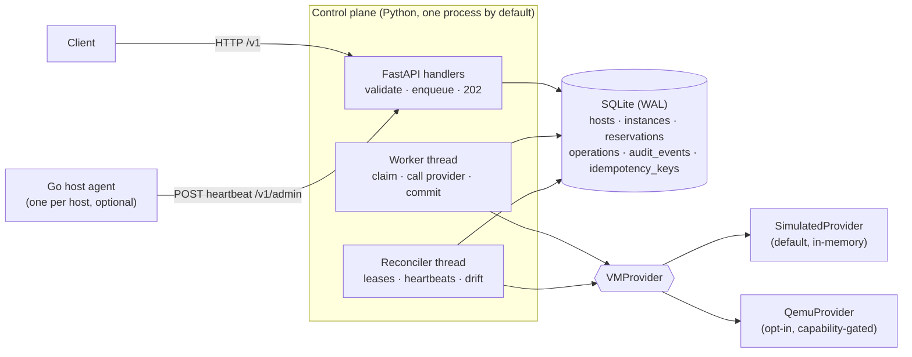

# Architecture

## Components and process layout



| Component | Code | Runs as | Independently deployable? |
|---|---|---|---|
| API | `vmlm/api/` | uvicorn process | yes |
| Worker | `vmlm/domain/worker.py` | thread in the API process, or `python -m vmlm.worker_main` | yes (`VMLM_WORKER_ENABLED=false` on the API) |
| Reconciler | `vmlm/domain/reconciler.py` | thread in the API process | no (runs with the API) |
| Scheduler | `vmlm/domain/scheduler.py` | library, inside DB transactions | no |
| Providers | `vmlm/providers/` | library, called by worker/reconciler | no |
| Host agent | `agent/` (Go) | one process per host | yes, optional |

The API and the worker communicate **only through the database**. There is no in-memory
queue, so a request accepted by one process can be executed by another, and nothing
accepted is lost if a process dies.

## Request flow

```mermaid
sequenceDiagram
  participant C as Client
  participant A as API
  participant D as DB
  participant W as Worker
  participant P as Provider
  C->>A: POST /v1/instances (Idempotency-Key)
  A->>D: BEGIN IMMEDIATE; place (best fit); insert instance PROVISIONING,<br/>reservation, operation PENDING, audit; COMMIT
  A-->>C: 202 + Location: /v1/operations/{id}
  W->>D: BEGIN IMMEDIATE; claim oldest due PENDING op; lease; COMMIT
  W->>P: provision(provider_id) with deadline (no DB lock held)
  P-->>W: ok
  W->>D: BEGIN IMMEDIATE; verify lease owner + instance version;<br/>PROVISIONING→RUNNING; op SUCCEEDED; audit; COMMIT
  C->>A: GET /v1/operations/{id}
  A-->>C: 200 {status: SUCCEEDED}
```

## Module responsibilities

| Module | Responsibility |
|---|---|
| `api/routers.py` | thin handlers; HTTP status policy (`accepted_status`) |
| `api/schemas.py` | request validation (strict ints, bounds, name pattern, `extra="forbid"`) |
| `api/errors.py` | domain error → HTTP mapping, uniform error body |
| `api/middleware.py` | request IDs, HTTP metrics, last-resort 500 without leaking details |
| `api/deps.py` | dependency injection, two-tier API-key auth |
| `domain/states.py` | state machine tables: transitions, action→states, desired state |
| `domain/core.py` | `tx` / `read_tx`, `apply_transition` (the only state-change path), audit |
| `domain/service.py` | request path: idempotency, transition, placement, enqueue |
| `domain/worker.py` | claim/lease, deadlines, retry/backoff, outcomes |
| `domain/reconciler.py` | lease recovery, heartbeat staleness, drift correction |
| `domain/scheduler.py` | best-fit placement and accounting over `reservations` |
| `domain/failures.py` | dev-only control-plane failure injection |
| `providers/` | `VMProvider` protocol, simulated and QEMU implementations |
| `sysinfo.py` | safe subprocess, signals, pids, resources, ports, virtualization detection |
| `observability/` | metrics registry, correlation-ID context |

## Logs, metrics, traces, audit records

| | What it answers | Here |
|---|---|---|
| **Logs** | "What happened in this process, in order?" Free-form, per event, for debugging. | JSON lines with `request_id`/`operation_id` on every record |
| **Metrics** | "How much / how often / how slow, over time?" Aggregated numbers, cheap to store, for dashboards and alerts. | `/metrics`, Prometheus text format |
| **Traces** | "Where did the time go in this one request across services?" Causally linked spans. | **Not implemented.** The request ID is propagated from API to worker, which is the correlation half of tracing; OpenTelemetry spans are future work. |
| **Audit records** | "Who changed what, when, and why?" Durable, per entity, part of the product. | `audit_events` table, `GET /v1/instances/{id}/events` |

Logs and metrics are operational and may be sampled or dropped; audit records are written
in the same transaction as the change they describe and are never dropped.

## Metrics

Label values are always drawn from bounded sets (action names, outcomes, configured host
names, route templates). Instance IDs, request IDs and user input are never labels.

| Name | Type | Unit | Labels |
|---|---|---|---|
| `vmlm_http_requests_total` | counter | requests | `method`, `route` (template), `status` |
| `vmlm_http_request_duration_seconds` | histogram | seconds | `method`, `route` |
| `vmlm_operations_total` | counter | operations | `action`, `outcome` (succeeded/failed) |
| `vmlm_operation_duration_seconds` | histogram | seconds (accept → completion) | `action` |
| `vmlm_operation_attempts_total` | counter | attempts | `action` |
| `vmlm_provider_failures_total` | counter | failures | `operation`, `kind` (transient/permanent) |
| `vmlm_scheduler_rejections_total` | counter | rejections | `reason` |
| `vmlm_host_capacity` | gauge | vCPUs or MiB | `host`, `resource`, `kind` (total/reserved) |
| `vmlm_operations_pending` | gauge | operations | none |
| `vmlm_reconcile_repairs_total` | counter | repairs | `kind` |

The registry is ~150 lines of dependency-free Python in `observability/metrics.py`; it is
per process, so a separate worker process exposes no metrics endpoint of its own (a known
gap, see the README).
