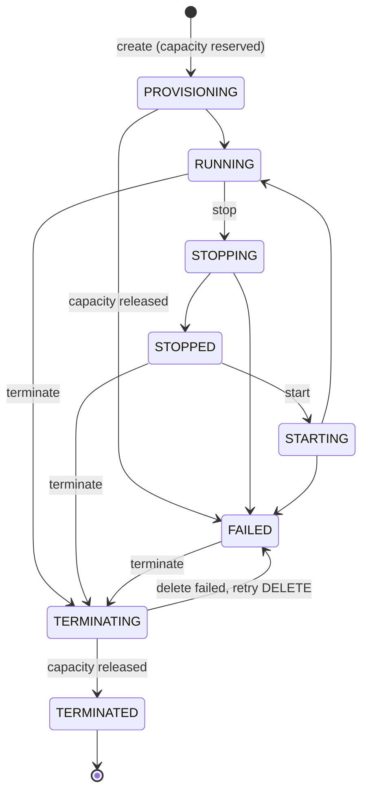
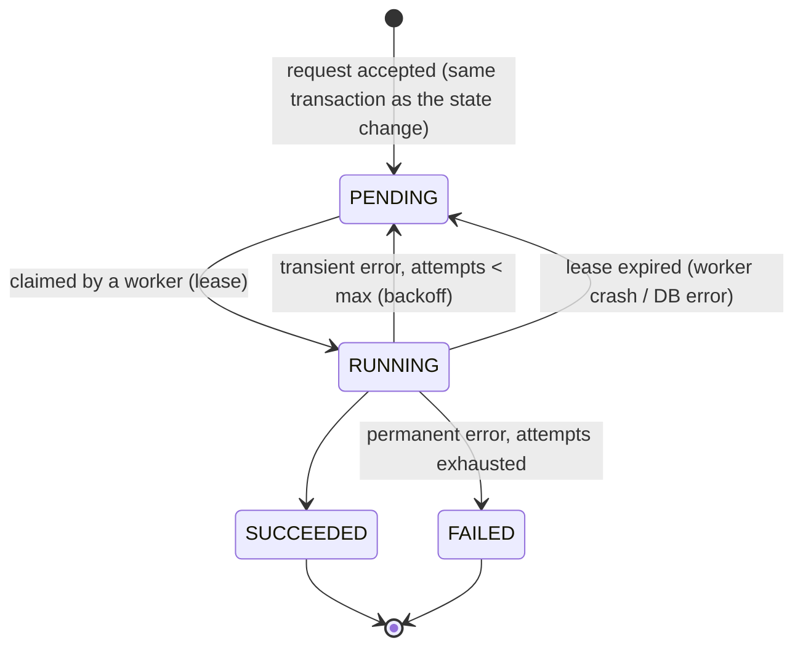

# State machine

All rules live in tables in `src/vmlm/domain/states.py` and `domain/reconciler.py`; there
are no scattered `if state == ...` checks. Every state change goes through
`domain/core.apply_transition`, which validates against the table, bumps the instance
`version`, and writes an audit record in the same transaction.

## Instance states

* The `-ING` states are committed *before* the provider is called. A crash therefore
  leaves a visible, typed marker rather than an unknown.
* `STARTING` and `TERMINATING` are additions to the seven states in the original brief:
  without them a crash during start or terminate would be indistinguishable from a VM that
  never received the request.
* `FAILED` has exactly one exit: terminate. The control plane never guesses whether a
  failed VM is safe to restart.
* Any transition not in the table returns `409 invalid_transition` with
  `{current_state, target_state}`. Tests check all 64 state pairs against the table.

## Desired state

Each instance also stores `desired_state` (`RUNNING`, `STOPPED`, `TERMINATED`), set by the
last accepted user action. The reconciler compares desired state with what the provider
reports.

## Operations

Each operation records: id, instance id, action, from/target state, attempts, max attempts,
error and error kind, request id, created/started/completed timestamps, next attempt time,
lease owner and expiry.

## Termination vs deletion

`DELETE /v1/instances/{id}` **terminates**: the VM is destroyed at the provider, its
reservation is released, and the record stays as `TERMINATED` (readable, with full audit
history). There is no purge. A second `DELETE` is `409`, not a silent success: with
idempotency keys available, repeating a terminate is a client choice, not an accident.

## Resource accounting by state

| State | Holds a reservation? | Why |
|---|---|---|
| PROVISIONING | yes | reserved at accept time, so admission is decided once |
| RUNNING / STOPPING / STOPPED / STARTING | yes | a stopped VM keeps its slot |
| FAILED after provisioning | **no** | rolled back: nothing exists at the provider |
| FAILED after start/stop/delete, or "vm missing" | yes | the VM may still exist; release only on terminate |
| TERMINATING | yes | until the provider confirms deletion |
| TERMINATED | no | released exactly once |

## Observed-state corrections (reconciler)

Only the reconciler may change state from *observation*, and only through this table
(`OBSERVED_CORRECTIONS`), recorded as a `drift_detected` audit event:

| Recorded | Provider reports | Corrected to | Then |
|---|---|---|---|
| RUNNING | STOPPED | STOPPED | if desired RUNNING: queue `start` |
| STOPPED | RUNNING | RUNNING | if desired STOPPED: queue `stop` |
| RUNNING | (missing) | FAILED | keep capacity; never re-create |
| STOPPED | (missing) | FAILED | keep capacity; never re-create |

Instances with an operation in flight are skipped: the worker owns them.
